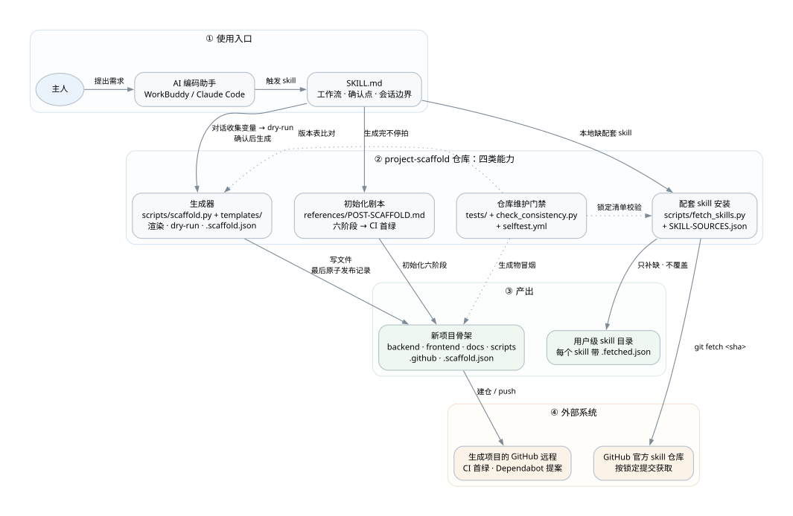

# project-scaffold

> 把一个空目录变成一个**有纪律、能跑、能测**的项目，并把它一路带到 CI 首绿。

这是一个 AI 编码工具（WorkBuddy / Claude Code 等）的 **Skill**，不是普通的代码模板仓库。
它由三部分组成：**一套模板文件** + **一个生成脚本** + **一份初始化剧本**。

模板只是骨架。真正有价值的是另外两样：

- **文档体系里的每一条纪律，都对应一次真实的翻车**——不是凭空想出来的规范；
- **四条机械守卫让「不做就过不去」**——纪律靠脚本落地，不靠自觉。

---

## 架构



四层：**使用入口 → 仓库四类能力 → 产出 → 外部系统**。逐层说明、关键边界与重绘方法见
[references/ARCHITECTURE.md](references/ARCHITECTURE.md)。

技术架构另分三张图：生成项目的**运行时**（前后端与数据库）、**质量与交付**（测试 / 守卫 / CI / 发布）、
以及**脚手架仓库自身**（脚本 / 离线测试 / selftest），见 [references/TECH-ARCHITECTURE.md](references/TECH-ARCHITECTURE.md)。

---

## 它解决什么

| 常见状况 | 这个项目怎么处理 |
|---|---|
| AI 生成的项目「跑不起来」，前后端没真正打通 | 首页那行字**必须来自后端接口**，这是「通了」的肉眼判据，不是装饰 |
| 文档写完就烂，改了代码没人同步 | 改代码 = 改文档，写进 `.codebuddy/rules/`，每次会话自动加载 |
| 未决事项散落在聊天记录里，下次开会话全丢 | 未决事项必须落 `docs/todo/` 成为文件，否则当次回复不算完 |
| 文档互相引用，文件一移动全是死链 | `check-doc-links.sh` 守着，断了过不去 |
| 待办解决完还留在 `docs/todo/` 里发霉 | `check-todo-archive.sh` 逼着 `git mv` 到 `archive/` |
| 版本号散落在 5 个文件里，发版时总漏改一处 | `check-version.sh` 比对 tag 与所有版本字符串 |
| 新模块写完没有测试，也没人发现 | `check-module-tests.sh` 检查每个业务模块有没有对应测试 |
| 骨架生成完就停拍，项目卡在「能编译但没上线」 | 初始化剧本六阶段，一路带到 **CI 首绿** |

---

## 快速开始

### 安装

把整个目录复制到所用 AI 工具的 skill 目录即可：

```bash
# WorkBuddy（用户级）
cp -r project-scaffold ~/.workbuddy/skills/

# Claude Code（用户级）
cp -r project-scaffold ~/.claude/skills/

# 或作为项目级 skill：放进项目里的 .workbuddy/skills/ 或 .claude/skills/
```

安装后对话里说一句「**我要做一个 xx 系统**」就会触发。

生成的项目两边都能用：WorkBuddy / CodeBuddy 自动加载 `.codebuddy/rules/`；
Claude Code 读根 `CLAUDE.md`，它导入 `AGENTS.md` 与四条规则。收尾命令 `/wrap-up` 只在 WorkBuddy 可用，
其他工具按 `AGENTS.md` 里的收尾清单做。

### 配套 skill（按需拉取）

初始化剧本用到两类外部 skill，都**不随本仓库分发**：

<!-- consistency:source-skills:start -->
| 类 | skill | 官方仓库 |
|---|---|---|
| 衔接用 | `grill-with-docs`（含 `grilling`、`domain-modeling`） | [mattpocock/skills](https://github.com/mattpocock/skills)（MIT） |
| 设计组（5 个） | `impeccable` | [pbakaus/impeccable](https://github.com/pbakaus/impeccable)（Apache-2.0） |
| | `make-interfaces-feel-better` | [jakubkrehel/make-interfaces-feel-better](https://github.com/jakubkrehel/make-interfaces-feel-better)（MIT） |
| | `web-design-guidelines` | [vercel-labs/agent-skills](https://github.com/vercel-labs/agent-skills)（仓库未声明许可） |
| | `shadcn-vue` | [unovue/shadcn-vue](https://github.com/unovue/shadcn-vue)（MIT） |
| | `ui-ux-pro-max` | [nextlevelbuilder/ui-ux-pro-max-skill](https://github.com/nextlevelbuilder/ui-ux-pro-max-skill)（MIT） |
<!-- consistency:source-skills:end -->

本地没有时，AI 会先用 `scripts/fetch_skills.py --check` 列出缺哪些、从哪个仓库的**固定提交**安装，
**经使用者一次确认后**才拉取；已装的一律不动。新安装会写 `.fetched.json` 记录来源、完整提交与原始文件摘要。
`--outdated` 可以只读比较本机记录、锁定基线与上游分支头，但它不升级、不覆盖任何 skill。
完整规则见 [references/SKILL-FETCHING.md](references/SKILL-FETCHING.md)。

⚠️ **拉到的不是上游「完全体」**：只复制 skill 目录、不跑上游安装器，所以 `impeccable` 的 hooks、
`ui-ux-pro-max` 的 CLI 安装器 / 模板 / 展示页都不装。这是刻意的取舍，理由记在生成项目的 `docs/design/设计skill清单.md` 里。

### 用法

人工在自己的终端里可以不带参数进入交互问答；AI 调用时不要使用交互模式（会停在 `input()` 等待输入），
应先在对话里确认变量，再用显式参数模式。AI 必须显式传入已经确认的绝对 `--out`，不依赖脚本的 `./<name>` 默认值。

```bash
# 先预览：把这组最终参数的文件计划、开关、目标目录状态与脚手架来源展示给使用者
python scripts/scaffold.py --name my-app \
    --package com.example.myapp \
    --out E:/code/my-app --dry-run

# 使用完全相同的参数生成；参数变化或要加 --force 时必须重新 dry-run
python scripts/scaffold.py --name my-app \
    --package com.example.myapp \
    --out E:/code/my-app
```

`--dry-run` 只预览生成文件，不代表数据库、后端或前端已经跑通；生成前确认不替代后续 commit、push、建远程仓库和拉配套 skill 的确认点。

需要把预览交给程序解析时，加 `--json`（**只能与 `--dry-run` 一起用**）：计划以 JSON 写到 stdout，
错误仍写 stderr，默认文本输出不变。JSON 与实际生成共用同一份文件计划，字段含参数、开关、目标目录状态、
文件清单与 `scaffold_record`（即将写入的 `.scaffold.json` 内容）。

```bash
python scripts/scaffold.py --name my-app --package com.example.myapp \
    --out E:/code/my-app --dry-run --json
```

JSON 只是机器可读的预览，正式生成仍使用去掉 `--json` / `--dry-run` 的同一组参数，并且同样要先经使用者确认。

脚本**只用 Python 标准库**，Python 3.11+ 即可，无任何第三方依赖。

⚠️ **产物只落在 `--out` 指定的目录**，绝不在当前仓库根生成。

### 三个开关（互相独立，默认都不开）

| 开关 | 生成什么 | 什么时候开 |
|---|---|---|
| `--with-deploy` | `release.yml`、`docker-compose.prod.yml`、`scripts/server-*.sh`、`deploy/` 模板 | 确定要上线到服务器时 |
| `--with-ops` | `docs/operations/内存策略.md`（预设 2C2G 的算法与示例） | 跑在小机器上、或要共用服务器时 |
| `--with-testing` | `docs/testing/` 分层规范与同步纪律 | 准备认真写测试时 |

### 常用参数

| 参数 | 默认 | 说明 |
|---|---|---|
| `--name` | （必填） | 项目名，kebab-case，同时是 npm 包名 / compose 项目名 / 容器名前缀 |
| `--package` | `com.example.<name 去掉连字符>` | Java 包名（如 `demo-app` → `com.example.demoapp`） |
| `--out` | `./<name>` | 输出目录 |
| `--version` | `0.1.0` | 初始版本号 |
| `--backend-port` / `--frontend-port` / `--web-port` | `8080` / `5173` / `8081` | 端口 |
| `--db` | 由项目名派生 | 数据库名 |
| `--modules` | 无 | 额外业务模块（逗号分隔），只建空包骨架 |
| `--dry-run` | 关 | 只打印将要创建的文件，不落盘 |
| `--json` | 关 | 与 `--dry-run` 配合，把计划输出为机器可读 JSON |
| `--force` | 关 | 目标已存在时覆盖模板产物（不删其他文件） |

---

## 生成什么

| 模板目录 | 落到新项目 | 开关 |
|---|---|---|
| `root/` | 仓库根（`README.md` / `AGENTS.md` / `CLAUDE.md` / `GLOSSARY.md` / `PRODUCT.md` / `DESIGN.md` / `CHANGELOG.md` / `.env.example` / `.gitignore` / `.gitattributes` / `.github/dependabot.yml`；另由生成器直接写 `.scaffold.json`） | 总是 |
| `rules/` | `.codebuddy/rules/`（四条，每次会话自动加载） | 总是 |
| `commands/` | `.codebuddy/commands/`（收尾命令 `/wrap-up`） | 总是 |
| `docs/` | `docs/`（地图 + 目录树 + ADR + 需求 + 设计 + 待办 + 会话工作台 + 开发规约） | 总是 |
| `backend/` | `backend/`（Spring Boot 3.5 + MyBatis-Plus + Flyway + JWT） | 总是 |
| `frontend/` | `frontend/`（Vue 3 + Vite + TypeScript + Pinia + Tailwind v4 + shadcn-vue） | 总是 |
| `ci/` | `.github/workflows/` | 总是 |
| `docker/` | 仓库根（`docker-compose.dev.yml`，只起数据库） | 总是 |
| `scripts/` | `scripts/`（四条守卫脚本） | 总是 |
| `testing/` | `docs/testing/` | `--with-testing` |
| `ops/` | `docs/operations/` | `--with-ops` |
| `deploy/` | 仓库根（内含 `.github/`、`scripts/`、`deploy/` 三段） | `--with-deploy` |

生成后恒定存在的目录（空的补 `.gitkeep`）：`docs/adr`、`docs/design`、`docs/development`、
`docs/operations`、`docs/requirements`、`docs/testing`、`docs/todo/archive`、`docs/worklog`。

### 生成记录

正式生成还会在项目根写 `.scaffold.json`：记录脚手架来源提交（能识别时）、生成器/模板是否有本地改动，
以及本次生成的项目参数。它默认生成、建议入库，用于追溯「从哪版骨架、按哪些选项开始」；
**不是当前配置的真相源，也不是升级依据**。dry-run（文本与 JSON）都会提前展示这份记录。
完整说明见 [references/SCAFFOLD-METADATA.md](references/SCAFFOLD-METADATA.md)。

---

## 四条机械守卫

纪律不靠自觉，靠「不做就过不去」：

```bash
bash scripts/check-doc-links.sh      # 文档链接断了 → 红
bash scripts/check-todo-archive.sh   # 已解决的待办还留在 todo/ → 红
bash scripts/check-module-tests.sh   # 业务模块没有对应测试 → 红
bash scripts/check-version.sh        # 版本字符串与 git tag 不一致 → 红
```

⚠️ 链接守卫只扫**已入库**的文件——`git add` 之前跑等于没验。

---

## 初始化剧本：从「生成完」到「CI 首绿」

生成完不停拍。先完成上面的 dry-run 总览确认，再照 `references/POST-SCAFFOLD.md` 走六阶段：

| # | 阶段 | 步骤 | 过线判据 |
|---|------|------|----------|
| ① | 入库基线 | `git init` → `git add -A` → 跑四条守卫 → 首次提交 | 四条守卫全绿 |
| ② | 依赖就位 | `mvn -B -ntp test`；`npm install && npm run typecheck` | 后端单测通过、前端无类型错误、锁文件入库 |
| ③ | 本地跑通 | 选择 Docker MySQL 或专用外部 MySQL → 配本地值 → 起后端 → 起前端 | 有 MySQL 时后端 200、**首页那行字来自后端**；没有 MySQL 时明确记录联通项受阻 |
| ④ | 门禁复核 | 守卫 + typecheck + `mvn test` 再跑一遍 | 全绿 |
| ⑤ | 入库远程 ⛔ | `gh repo create` → push → 盯 CI | **CI 首绿**（红着不算完） |
| ⑥ | 完成衔接 | 检查配套 skill → 提示手动触发需求打磨 | 提示已给出 |

判据一律「**看产物**」，不看退出码。

AI 在这几处必须**先问使用者、拿到确认再做**：每次 `git commit` / `git push`（同一阶段可一次确认）、
⑤ 建远程仓库（问仓库名与公开/私有）、⑥ 拉取本地没有的配套 skill。

---

## 设计取舍

**只搬通用件。** 判据：这个类换一个业务域名还成不成立？成立 → 搬；只有某个项目的业务决策才需要 → 不搬。

不搬的例子：token 版本号失效机制、账号硬删与清理、头像存储策略、判分工具、Excel 导入导出——
这些都是业务决策，脚手架不该预设。

其他刻意的取舍：

- 后端依赖版本**钉死**（清单见 [references/TECH-STACK.md](references/TECH-STACK.md) 的版本表），不写 `<latest>`；
  前端用 `^` / `~` 范围，实际安装版本由初始化时生成的 `package-lock.json` 固定；
- 集成测试用 **Testcontainers + 真 MySQL**，不用 H2——迁移脚本是 MySQL 方言，用 H2 等于把「测试环境与真实环境不一致」请回来；
  模板自带一个最小的 `ExampleApiIT`，让 `mvn verify` 首日就有真库覆盖；
- 前端 Dockerfile **必须 glibc 基础镜像**（Node 的 slim 镜像，非 alpine）——esbuild 没有 x64-musl 官方二进制；
- 模板里**没有任何真实凭据**：密钥、密码、服务器 IP 全是占位符，真实值一律走 GitHub Secrets；
- 配套 skill **按固定提交安装**并记录来源，不追上游最新分支头；`--outdated` 只报告差异，不自动升级；
- 色值**不预设**：`tokens.css` 只给中性灰阶 + 一个标 TODO 的主色，产品身份留给新项目自己。

---

## 本仓库结构

```
project-scaffold/
├── SKILL.md                 # Skill 入口：工作流、会话边界、注意事项
├── README.md                # 本文件
├── references/              # 给 AI 看的详细规范
│   ├── POST-SCAFFOLD.md     # ★ 初始化剧本（六阶段 + 确认点 + 判据 + 衔接段）
│   ├── VARIABLES.md         # 变量表、占位符语法（只有全大写会被替换）、目录映射
│   ├── DOC-SYSTEM.md        # 文档体系搬了什么、改成什么样
│   ├── TECH-STACK.md        # 后端 / 前端 / Docker / CI 的取舍，以及不搬的业务件
│   ├── FRONTEND-SYSTEM.md   # 前端设计体系三层与色值口径
│   ├── TESTING-SYSTEM.md    # 测试规范；e2e 与探索测试为什么明确不沉淀
│   ├── QUALITY-POLICY.md    # 成熟度三档、静态分析与 lint 的取舍
│   ├── SKILL-SOURCES.json   # 配套 skill 的固定提交与监测分支
│   ├── SKILL-FETCHING.md    # 固定基线安装、来源记录与过期检查的规则
│   ├── SCAFFOLD-METADATA.md # 生成记录 .scaffold.json 的语义与边界
│   ├── ARCHITECTURE.md      # 流程架构图与四层说明
│   ├── architecture.dot     # 流程架构图的 Graphviz 源文件
│   ├── architecture.svg     # 流程架构图（由 .dot 生成）
│   ├── TECH-ARCHITECTURE.md # 技术架构：运行时 / 质量与交付 / 仓库自身
│   ├── architecture-runtime.dot / .svg   # 生成项目运行时
│   ├── architecture-quality.dot / .svg   # 测试 / 守卫 / CI / 发布
│   └── architecture-selftest.dot / .svg  # 脚手架仓库自身
├── scripts/
│   ├── scaffold.py          # 生成脚本（仅标准库）
│   ├── check_consistency.py # 仓库自身维护检查：版本表 / skill 清单 / 架构图（离线、只读）
│   ├── check_diagrams.py    # 架构图防漂移：.dot ↔ .svg ↔ 文档引用与图内事实
│   └── fetch_skills.py      # 配套 skill 按固定基线安装（本地没有才拉，不覆盖）
├── tests/                   # 仓库自身离线回归测试（unittest，仅标准库）
├── .github/workflows/
│   ├── selftest.yml         # 每次 push / PR：Python 回归 + 一致性检查 + 生成物守卫冒烟
│   └── full-build.yml       # 每周定时 / 手动 / 模板 PR：真实构建生成的后端与前端
└── templates/               # 模板文件（见上文「生成什么」）
```

---

## 本仓库自测

这是脚手架仓库自身的离线回归测试，不是生成项目里的 Java 测试：

```bash
python -m unittest discover -s tests -v
python scripts/check_consistency.py
```

测试只使用 Python 标准库和隔离临时目录，不访问 GitHub、Docker、MySQL、Maven、npm 或真实用户 skill 目录。
它覆盖生成器/拉取器的输入校验、模板渲染、dry-run 无副作用与 JSON 计划、可选开关、覆盖保护、固定提交安装、
来源记录与过期检查、`.scaffold.json` 的参数与来源识别、Dependabot 模板的结构与生成结果、
完整构建工作流的触发条件与命令，以及架构图源文件、SVG、文档引用和图内事实的一致性。

`check_consistency.py` 是另一道只读门禁：把 [references/TECH-STACK.md](references/TECH-STACK.md) 的版本表
与模板 `pom.xml` / `package.json` / Dockerfile，以及 CI 工作流里写死的 JDK / Node 版本对齐，
并核对四张配套 skill 清单表、`fetch_skills.py` 的登记表和 `SKILL-SOURCES.json` 的提交格式与仓库覆盖。
它还会调用 `check_diagrams.py`，确认每张图的 `.dot` 与 `.svg` 没有漂移、SVG 被文档引用，
图里的版本 / 端口 / Python 矩阵与真相源一致。三组检查都可以用 `--only versions|skills|diagrams` 单独运行。
它不联网、不调用 Maven/npm，也不解析依赖的远程有效版本。

`.github/workflows/selftest.yml` 在 GitHub 上跑同一套测试（Python 3.11 / 3.12 / 3.13）与一致性检查，
并在临时目录生成全开关项目、跑四条生成项目守卫；一致性检查也会核对 CI 里写死的 JDK / Node 版本。

`.github/workflows/full-build.yml` 是另一层门禁：每周定时、手动触发，以及改动 `templates/**` 或
`scripts/scaffold.py` 的 PR 上，用模板真实生成一个项目，再跑后端 `mvn -B -ntp verify`（含模板自带的
Testcontainers 集成测试）和前端 `npm install → typecheck → build`，并确认 jar 与 `dist/index.html`
真的存在、failsafe 报告确实产生。它需要网络与真实 toolchain，是分钟级任务，所以不挂在每次 push 上。
模板不带 `package-lock.json`，因此这里用 `npm install` 而不是 `npm ci`。

两层 CI 都**不覆盖**真实数据库、浏览器、外部 skill 拉取，也不验证 Dependabot 服务的实际开 PR 行为；
真实固定提交安装仍只做人工验收。

---

## 环境要求

生成脚本本身只需要 **Python 3.11+**。生成项目的基础门禁需要 **JDK 21+**、**Maven 3.9+**、
**Node.js 22+** 和 **npm**；后端纯单测与前端 typecheck/build 不需要 Docker 或数据库。

要跑真实后端并验证前后端联通，需要一个可访问的 **MySQL 8**，可以用 Docker Compose 启动本机库，
也可以使用专用外部 MySQL。Testcontainers 集成测试、镜像冒烟与发布流程仍需要容器运行环境。

---

## 许可

MIT。见 [LICENSE](./LICENSE)。
