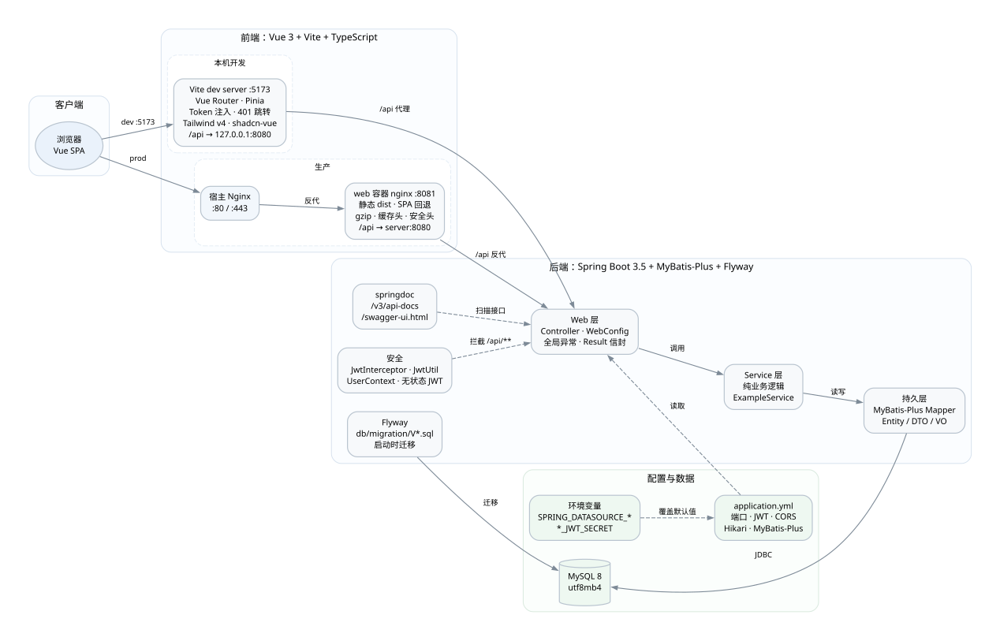
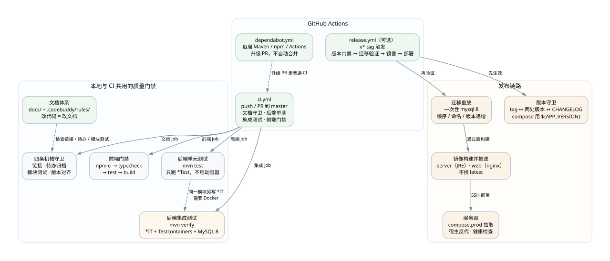
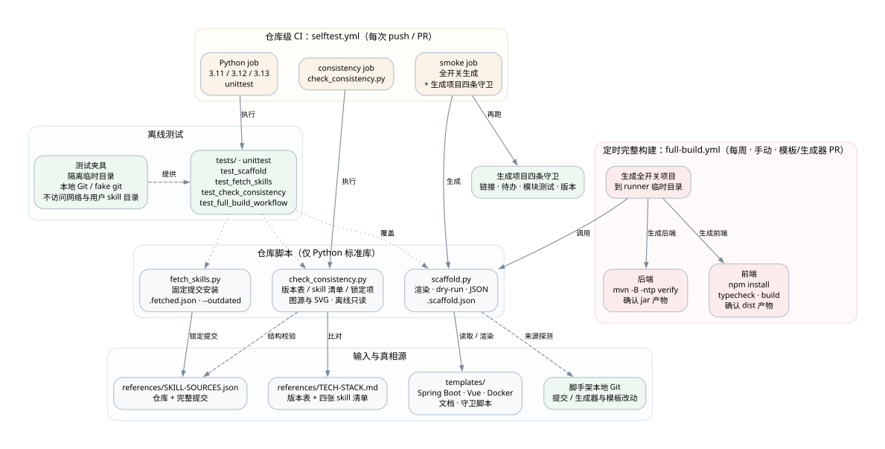

# 技术架构

流程架构见 [`ARCHITECTURE.md`](./ARCHITECTURE.md)。本文件拆开技术栈，分三张图：

| 图 | 回答什么 |
|---|---|
| [生成项目运行时](#一生成项目运行时) | 前后端怎么连、数据怎么走、开发和生产的差别 |
| [质量与交付](#二质量与交付) | 单元 / 集成测试、四条守卫、CI、发布链路 |
| [脚手架仓库自身](#三脚手架仓库自身) | Python 脚本、离线测试与 selftest CI 的关系 |

三张图都由 Graphviz 生成，源文件同目录，改图请改 `.dot` 后重新渲染。

## 技术栈速览

| 层 | 选型 | 版本 / 取舍 |
|---|---|---|
| 后端 | Spring Boot 3.5 + MyBatis-Plus + Flyway + JWT（jjwt）+ springdoc + MapStruct / Lombok | 精确版本见 [`TECH-STACK.md`](./TECH-STACK.md) 的版本表 |
| 数据库 | MySQL 8（utf8mb4） | 本机 Docker 或专用外部 MySQL；迁移脚本是 MySQL 方言 |
| 前端 | Vue 3 + Vite + TypeScript + Pinia + Vue Router + Tailwind v4 + shadcn-vue | 范围版本 + `package-lock.json` 固定实际安装版本 |
| 构建 | Maven（后端）、npm + Vite（前端） | 依赖版本由模板钉住；Dependabot 只提案 |
| 测试 | JUnit 5 / Mockito、Testcontainers、vue-tsc、四条 shell 守卫 | 单测不需要容器；集成测试需要 MySQL |
| CI/CD | GitHub Actions（ci / release / selftest）+ Docker + Nginx | 发布链路仅在 `--with-deploy` 时生成 |
| 生成器 | Python 3.11+ 标准库 | 无第三方依赖，离线测试 |

可选章节：`--with-deploy`（release.yml、prod compose、服务器脚本）、`--with-ops`（内存策略）、
`--with-testing`（测试规范文档）。不开时对应文件不存在，其余架构不变。

---

## 一、生成项目运行时



### 本机开发

```
浏览器 :5173 → Vite dev server → /api 代理 → Spring Boot :8080 → MySQL :3306
```

- 前端在宿主机跑 `npm run dev`，Vite 把 `/api` 代理到 `127.0.0.1:8080`，所以开发期不需要 CORS。
- 后端在宿主机跑 `mvn spring-boot:run`；数据库可以是 Docker Compose 起的本机 MySQL，
  也可以是专用外部 MySQL，用 `SPRING_DATASOURCE_*` 覆盖连接。
- 首页那行字来自 `GET /api/example/hello`，是「前后端真的通了」的肉眼判据。

### 生产

```
浏览器 :80/443 → 宿主 Nginx → web 容器 nginx :8081 → /api → server 容器 :8080 → mysql 容器 :3306
```

- web 容器只绑 `127.0.0.1:${WEB_PORT}`，对外入口交给宿主反代；server 容器不发布端口。
- 前端镜像用 `node:22-slim` 构建、`nginx:alpine` 运行；后端镜像用 Maven 构建、Temurin JRE 运行。
- `docker-compose.prod.yml` 里没有 `build:`：镜像只由 CI 构建推送，服务器只拉取。

### 后端分层

| 层 | 内容 | 说明 |
|---|---|---|
| Web | `Controller`、`WebConfig`、`GlobalExceptionHandler`、`Result` 信封 | `/api/**` 统一走 JWT 拦截器；登录注册、示例接口与文档路径放行 |
| 安全 | `JwtInterceptor`、`JwtUtil`、`UserContext` | 无状态 JWT；密钥从配置读，公开默认值会被替换为随机密钥 |
| Service | `ExampleService` 等 | 纯业务逻辑，不依赖 Spring 容器，便于纯 JUnit 测试 |
| 持久 | MyBatis-Plus `Mapper`、`Entity`、`DTO`、`VO` | `update-strategy: not_null` 是刻意保留的坑，注释里写明 |
| 迁移 | `db/migration/V*.sql` | Flyway 启动时执行；脚本只追加、不修改已上线版本 |
| 文档 | springdoc `/v3/api-docs`、`/swagger-ui.html` | 接口清单以运行时为准，文档不维护 endpoint 表 |

配置的真实来源：

- `backend/src/main/resources/application.yml` 给本机默认值；
- 容器与外部 MySQL 用 `SPRING_DATASOURCE_*` 覆盖；
- JWT、CORS、版本号用 `APP_ENV_PREFIX` 派生的环境变量覆盖；
- `.env.example` 入库，`.env` 不入库；Maven 直跑不会自动读 `.env`。

---

## 二、质量与交付



### 测试分层

| 命令 | 跑什么 | 需要什么 |
|---|---|---|
| `mvn test` | `*Test` 纯单元测试（surefire） | 不需要数据库、不需要 Docker |
| `mvn verify` | 追加 `*IT` 集成测试（failsafe） | Testcontainers + 真 MySQL，需要容器环境 |
| `npm run typecheck` | `vue-tsc --noEmit` | Node 与已安装依赖 |
| `npm run build` | Vite 打包 | ⚠️ esbuild 只剥离类型、不做检查；类型错误只由 typecheck 挡住 |

`surefire` 不认 `*IT` 这个命名，所以 `mvn test` 刻意保持轻量；接口与落库测试显式走 `mvn verify`。

### 四条机械守卫

| 脚本 | 拦什么 |
|---|---|
| `check-doc-links.sh` | 文档相对链接、`CLAUDE.md` 导入、脚本里提到的仓库路径 |
| `check-todo-archive.sh` | 已结案待办必须在 `docs/todo/archive/` 且登记 |
| `check-module-tests.sh` | 带 Controller 的模块必须配测试类 |
| `check-version.sh` | tag、两处版本、CHANGELOG、compose 的 `${APP_VERSION}` |

### CI 与发布

- `ci.yml`（总是生成）：push / PR 到 master，跑文档守卫、后端 `mvn test`、后端 `mvn verify`（Testcontainers 集成测试）、
  前端 `npm ci → typecheck → build`。
- `release.yml`（`--with-deploy` 才生成）：推 `v*` tag 后依次做版本门禁 → 一次性 `mysql:8` 重放迁移
  → 构建并推送两个镜像 → SSH 部署；**不推 `latest`**，回滚落点是版本 tag。
- `dependabot.yml`（总是生成）：每周为 Maven / npm / GitHub Actions 提升级 PR，只提案、不自动合并，
  也不触发部署；基础镜像与 MySQL 镜像不在覆盖范围。

`ci.yml` 把单测与集成测试分成两个 job：单测不启动 Docker、几秒出结果；集成测试跑 `mvn verify`，
由 Testcontainers 起真 MySQL 并执行 Flyway 迁移。镜像冒烟与端到端仍不放进骨架。

---

## 三、脚手架仓库自身



- **脚本**：`scripts/scaffold.py`、`scripts/fetch_skills.py`、`scripts/check_consistency.py`，
  只用 Python 3.11+ 标准库。
- **输入与真相源**：`templates/`、`references/TECH-STACK.md` 的版本表、`references/SKILL-SOURCES.json`、
  脚手架自身的本地 Git（生成记录来源探测）。
- **离线测试**：`tests/` 下的 unittest，使用隔离临时目录、本地 Git 仓库与 fake git；
  不访问网络、Docker、数据库或真实用户 skill 目录。工作流文件本身也有一组离线断言
  （`test_full_build_workflow.py`），守住触发条件、只读权限与构建命令不被误改。
- **selftest.yml** 三个 job（每次 push / PR）：
  - Python 3.11 / 3.12 / 3.13 跑全部 unittest；
  - `check_consistency.py` 校验版本表、四张 skill 清单、锁定清单，以及 CI 里写死的 JDK / Node 版本；
  - 在临时目录生成全开关项目，再跑生成项目的四条守卫。
- **full-build.yml** 两个 job（每周定时 · 手动 · 模板或生成器改动的 PR）：
  - 后端：生成全开关项目 → `mvn -B -ntp verify` → 确认 jar；
  - 前端：生成同一份项目 → `npm install`（模板没有锁文件，不能用 `npm ci`）→ typecheck → build → 确认 `dist/index.html`。
  - 这是「模板写错了」在发布前被拦住的关卡：生成项目自己的 `ci.yml` 要等使用者建仓推送后才运行。
    它需要真实 toolchain 与网络，分钟级，所以不挂在每次 push 上。

`selftest.yml` 离线、秒级；`full-build.yml` 联网、分钟级，并会执行模板自带的 Testcontainers 集成测试。
两者都不拉取外部 skill、不连接生产数据库或浏览器，真实固定提交安装仍只做人工验收。

---

## 四、重新生成图片

```bash
dot -Tsvg references/architecture-runtime.dot    -o references/architecture-runtime.svg
dot -Tsvg references/architecture-quality.dot    -o references/architecture-quality.svg
dot -Tsvg references/architecture-selftest.dot   -o references/architecture-selftest.svg
```

需要 [Graphviz](https://graphviz.org/)。字体使用 `Microsoft YaHei`，缺少该字体的系统由渲染器替换。
只改文案时改 `.dot` 再重新生成，不手工编辑 SVG。

改完跑一次图漂移检查：

```bash
python scripts/check_consistency.py --only diagrams
```

它核对 `.dot` 与 `.svg` 的节点 / 簇 / 边、文档引用，以及图里登记的版本、端口与 Python 矩阵；
不检查颜色、布局和文字重叠。
